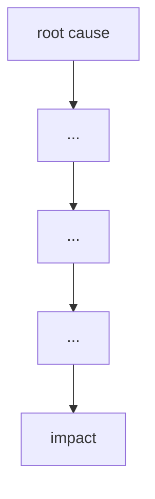

# Failure case analysis · <case> (v1.1, 2026-20-10)
Authors: <member per section>
        Sok Chungseang ## 1 & 2

        Seng Sarak ## 4
        Pheng Sopheak ## 5
        Oeung Keangheang ## 6
        

## 1. Context
Organization: 
- Post Office Limited
- Fujitsu
- Subpostmasters
System: 
- Legacy Horizon: first deployment was affected by software bugs. 
- Horizon Online: Centralized re-architecture that continued generating false accounting losses.
- HNG-A: Windows-based platform iteration.
Users: 
- Subpostmasters using counter terminals under strict contractual shortfall liability
- Fujitsu Support Personnel possessing privileged access rights to remotely insert or edit branch database transactions. 
Why it matters: 
- A lot of subpostmaster were wrongly convicted of theft and false accounting while thousands more were forced to pay out of their own pocket for non-existent shortfall. This injustice led to a lot of bankruptcy and repossession.
- Post office and Fujitsu knew of the software bugs and covert remote database access tools, yet continue to publicly state that Horizon was infallible. They then continue to blamed postmaster regularly without allowing them access to backend audit. 
- The High court judgement shattered the legal fiction of system reliability which prompted the largest mass quashing of conviction .
## 2. Timeline
| Date | Event |
|------|-------|
|1999–2000|Post Office Counters Limited begins roll-out of the Horizon IT system across branches and Crown Offices, Internal Fujutsu incident logs records major software errors which causes large false branch discrepancies.|
|2005|The discovery of a critical navigation bug at the callendar square branch stock transfer failing to appear on the recieving end.|
|2010|Transition to Horizon Online, Major cache bug which causes shortfalls to zero out on counter screens.|
|2010–2015|The appearance of Local suspense bug and Dalmellington outreach bug.|
|2015–2016|It was concluded that the system at Horizon IT wasnt fit for purpose and was too expensive on top of the fact that it was difficult to change.| 
|2017|Transition to window based architecture|
|December 2019|Court confirms software bugs caused actual branch shortfalls and Fuhitsu was held un-audited remote access capabilities to alter branch figures.|

## 3. What failed
<one paragraph>

## 4. Root causes
| # | Root cause | Type | Essential difficulty | Why |
|---|------------|------|----------------------|-----|
| R1 | Software bugs and accounting errors in Horizon EPOS | technical | complexity | System glitches and bugs made local branch balances wrong and showed missing money that was not actually lost. |
| R2 | Fujitsu workers could quietly edit branch accounting data | process | invisibility | Fujitsu engineers had access to edit branch transaction data remotely without the subpostmasters knowing. |
| R3 | Post Office management blindly trusted the computer system | organisational | conformity | Management assumed Horizon was free of error, completely ignoring complaints. |

## 5. Practices that would have prevented or limited it
| Root cause | Practice | Chapter |
|------------|----------|---------|
| R1: Software bugs and accounting errors in Horizon EPOS | Unit tests and acceptance tests using realistic branch data; staged rollout to a few branches first | Chapter 08, Chapter 09 |
| R2: Fujitsu workers could quietly edit branch accounting data | Audit logs recording who changed what and when; access control with approval for remote changes; making those changes visible to the branch | Chapter 08 |
| R3: Post Office management blindly trusted the computer system | Independent review of the system's records before acting on them; logging and counting user complaints | Chapter 10, Chapter 03 |

## 6. Lessons for ITC Club Hub
1. Fail Safe on Network Syncs so the system processes only the first request and safely discards the retries if thre's a network issue. Additionally, Enforce Atomic Transactions where every multi-step operation must be wrapped in a single atomic database transaction (ACID compliant). If the user's connection drops halfway through a submission, the system must rollback completely rather than recording a partial state.
2. Provide Full User-Facing Audit Logs by building an immutable, user-visible Audit Trail Log page where officers and club members can view every balance change along with its timestamp, performing user ID, and source event ID. Upon data entry, enforce strict schema validation by rejecting inputs that are not integers between 1 and 500 and rejecting any event CSV upload that contains missing member IDs, invalid date formats, or duplicate email addresses.
## 7. Sources
1. <author or organisation, title, year, URL> (primary)
2. Bates & Others v Post Office Ltd (No 6: Horizon Issues) [2019] EWHC 3408 (QB), https://www.judiciary.uk/wp-content/uploads/2019/12/bates-v-post-office-judgment.pdf
3. Post Office Horizon IT Inquiry, Provisional List of Issues, 2021, https://www.gov.uk/government/publications/post-office-horizon-it-inquiry-2020/provisional-list-of-issues
4. Post Office Horizon IT Inquiry, Inquiry Report Volume 1, 2025, https://data.parliament.uk/DepositedPapers/Files/DEP2025-0465/2025-07-07-_HC_1119-_Post_Office_Horizon_IT_Inquiry_Report_Volume_1.pdf
