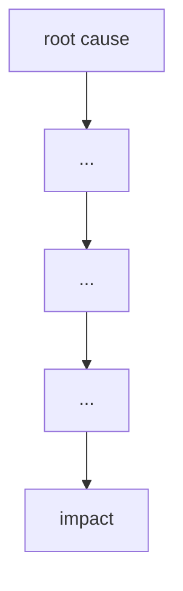

# Failure case analysis · <case> (v1.1, 2026-20-10)
Authors: <member per section>
        Oeung Keangheang ## 6

## 1. Context
## 2. Timeline
| Date | Event |
|------|-------|

## 3. What failed
<one paragraph>

## 4. Root causes
| # | Root cause | Type | Essential difficulty | Why |
|---|------------|------|----------------------|-----|
| R1 |           | technical | complexity | |
| R2 |           | process | invisibility | |
| R3 |           | organisational | conformity | |

## 5. Practices that would have prevented or limited it
| Root cause | Practice | Chapter |
|------------|----------|---------|

## 6. Lessons for ITC Club Hub
1. Fail Safe on Network Syncs so the system processes only the first request and safely discards the retries if thre's a network issue. Additionally, Enforce Atomic Transactions where every multi-step operation must be wrapped in a single atomic database transaction (ACID compliant). If the user's connection drops halfway through a submission, the system must rollback completely rather than recording a partial state.
2. Provide Full User-Facing Audit Logs by building an immutable, user-visible Audit Trail Log page where officers and club members can view every balance change along with its timestamp, performing user ID, and source event ID. Upon data entry, enforce strict schema validation by rejecting inputs that are not integers between 1 and 500 and rejecting any event CSV upload that contains missing member IDs, invalid date formats, or duplicate email addresses.
## 7. Sources
1. <author or organisation, title, year, URL> (primary)
2. Bates & Others v Post Office Ltd (No 6: Horizon Issues) [2019] EWHC 3408 (QB), https://www.judiciary.uk/judgments/bates-v-post-office-horizon-issues/
