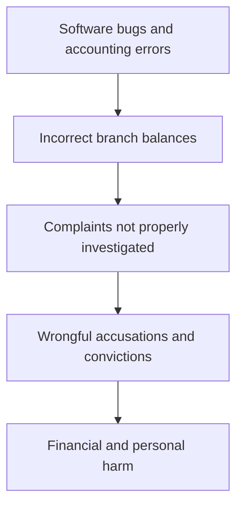

# Failure case analysis · <case> (v1.1, 2026-20-10)
Authors: <member per section>
        Oeung Keangheang ## 6
        Seng Sarak ## 4

## 1. Context
## 2. Timeline
| Date | Event |
|------|-------|

## 3. What failed
The Horizon computer system was full of glitches and accounting mistakes. Branch balances went off, money just disappeared without explanation. Fujitsu employees could get>

## 4. Root causes
| # | Root cause | Type | Essential difficulty | Why |
|---|------------|------|----------------------|-----|
| R1 | Software bugs and accounting errors in Horizon EPOS | technical | complexity | System glitches and bugs made local branch balances wrong and showed missing money that was not actually lost. |
| R2 | Fujitsu workers could quietly edit branch accounting data | process | invisibility | Fujitsu engineers had access to edit branch transaction data remotely without the subpostmasters knowing. |
| R3 | Post Office management blindly trusted the computer system | organisational | conformity | Management assumed Horizon was free of error, completely ignoring complaints. |

## 5. Practices that would have prevented or limited it
| Root cause | Practice | Chapter |
|------------|----------|---------|
| R1: Software bugs and accounting errors in Horizon EPOS | Unit tests and acceptance tests using realistic branch data; staged rollout to a few branches first | Chapter 08, Chapter 09 |
| R2: Fujitsu workers could quietly edit branch accounting data | Audit logs recording who changed what and when; access control with approval for remote changes; making those changes visible to the branch | Chapter 08 |
| R3: Post Office management blindly trusted the computer system | Independent review of the system's records before acting on them; logging and counting user complaints | Chapter 10, Chapter 03 |

## 6. Lessons for ITC Club Hub
1. Fail Safe on Network Syncs so the system processes only the first request and safely discards the retries if thre's a network issue. Additionally, Enforce Atomic Transactions where every multi-step operation must be wrapped in a single atomic database transaction (ACID compliant). If the user's connection drops halfway through a submission, the system must rollback completely rather than recording a partial state.
2. Provide Full User-Facing Audit Logs by building an immutable, user-visible Audit Trail Log page where officers and club members can view every balance change along with its timestamp, performing user ID, and source event ID. Upon data entry, enforce strict schema validation by rejecting inputs that are not integers between 1 and 500 and rejecting any event CSV upload that contains missing member IDs, invalid date formats, or duplicate email addresses.
## 7. Sources
1. <author or organisation, title, year, URL> (primary)
2. Bates & Others v Post Office Ltd (No 6: Horizon Issues) [2019] EWHC 3408 (QB), https://www.judiciary.uk/judgments/bates-v-post-office-horizon-issues/
3. Post Office Horizon IT Inquiry, Provisional List of Issues, 2021, https://www.gov.uk/government/publications/post-office-horizon-it-inquiry-2020/provisional-list-of-issues
4. Post Office Horizon IT Inquiry, Inquiry Report Volume 1, 2025, https://data.parliament.uk/DepositedPapers/Files/DEP2025-0465/2025-07-07-_HC_1119-_Post_Office_Horizon_IT_Inquiry_Report_Volume_1.pdf
