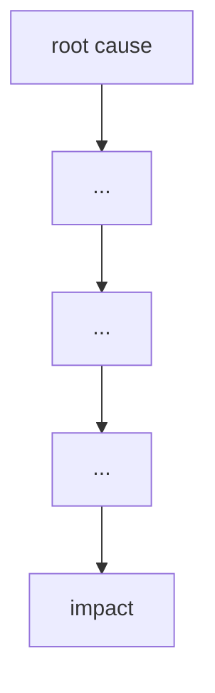

# Failure case analysis · <case> (v1.0, 2026-17-10)
Authors: <member per section>

## 1. Context
## 2. Timeline
| Date | Event |
|------|-------|

## 3. What failed
<one paragraph>

## 4. Root causes
| # | Root cause | Type | Essential difficulty | Why |
|---|------------|------|----------------------|-----|
| R1 |           | technical / process / organisational | | |

## 5. Practices that would have prevented or limited it
| Root cause | Practice | Chapter |
|------------|----------|---------|
| R1: Software bugs and accounting errors in Horizon EPOS | Unit tests and acceptance tests using realistic branch data; staged rollout to a few branches first | Chapter 08, Chapter 09 |
| R2: Fujitsu workers could quietly edit branch accounting data | Audit logs recording who changed what and when; access control with approval for remote changes; making those changes visible to the branch | Chapter 08 |
| R3: Post Office management blindly trusted the computer system | Independent review of the system's records before acting on them; logging and counting user complaints | Chapter 10, Chapter 03 |

## 6. Lessons for ITC Club Hub
1.
2.

## 7. Sources
1. <author or organisation, title, year, URL> (primary)
