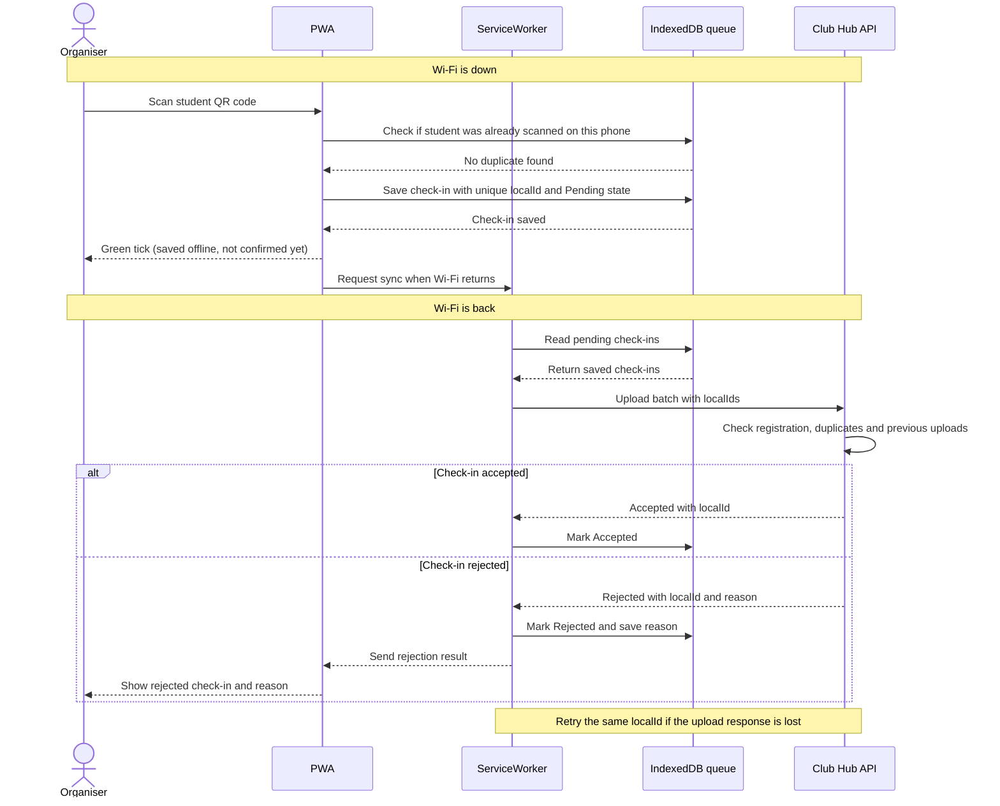

# Challenge · Offline-first check-in for Club Hub

## 1. Scenario

During Debate Night at Amphi A, 120 students arrive within 10 minutes through two doors. Each door has an organiser using Club Hub on their phone. Since the Wi-Fi can stop working for a few minutes, the check-in system should still let organisers scan students without waiting for the internet.

When a student is scanned, the PWA saves their check-in on the phone first and shows a green tick saying it was saved offline. Once the Wi-Fi comes back, the saved check-ins are sent to the server. The server will then check whether each student is registered and whether they have already checked in.

## 2. Sequence diagram

The green tick only means the check-in is saved on that phone. It does not mean the server has accepted it yet. This matters because the other door might have scanned the same student while both phones were offline.

## 3. Conflict rules

| # | Case | Winner | Organiser sees | Stored on the server |
|---|------|--------|----------------|----------------------|
| 1 | The same student is scanned at both doors | The first check-in successfully recorded by the server | Both phones show saved offline at first. After syncing, one is accepted and the other shows duplicate check-in. | Only one attendance record for that student and event. The duplicate is rejected and logged. |
| 2 | A student cancels their registration on the server while the phone is offline | The server's current registration status | The check-in is saved offline first, then shows rejected because the registration was cancelled. | No attendance record is added. The rejection reason is recorded. |
| 3 | A student who never registered tries to check in | The server's registration list | Not registered, either from the saved list on the phone or after syncing. | No attendance record. The failed check-in is logged. |
| 4 | The phone retries an upload that the server already accepted | The first accepted upload on the server | Accepted, without creating another check-in. | The server returns the previous result for the same localId and keeps only one attendance record. |
| 5 | The phone clock is 7 minutes wrong | The server's time | The check-in still works, but the phone's time is not used to decide who checked in first. | The server saves its own received time. The phone's scan time can be kept for checking problems. |

To prevent duplicates, the server checks both the student's ID with the event ID and the unique ID of each uploaded check-in. Only one successful attendance record should exist for the same student in the same event.

## 4. Queued check-in structure

The C++ structure is in `include/clubhub/queued_checkin.hpp`.

The `QueuedCheckIn` struct stores:

- `localId`: a unique UUID created by the phone for each check-in.
- `deviceId`: which organiser phone scanned the student.
- `eventId` and `studentId`: which event and student the check-in belongs to.
- `scannedAt`: when the phone recorded the scan. It may be wrong if the phone clock is incorrect.
- `attempts`: how many times the phone tried to upload the check-in.
- `state`: Pending, Sent, Accepted or Rejected.
- `rejectReason`: why the server rejected the check-in, if it was rejected.

The `CheckInQueue` class uses `enqueue` to add a check-in, `pending` to get check-ins that still need a server response, and `markAccepted` or `markRejected` to update the result. It also has `markSent` to record an upload attempt.

**Idempotency:** `localId` is what prevents a retried upload from being processed twice. The phone generates it once and keeps using the same ID when retrying. If the server already processed that ID, it returns the previous result instead of creating a new attendance record. Checking `eventId` and `studentId` also prevents the same student from checking in twice using two different phones.

The C++ queue currently stores its items in memory. The actual PWA would need IndexedDB so the records are still there if the page is closed or refreshed.

## 5. Effects on the quality scenarios

| Scenario | Effect of offline check-in |
|---|---|
| QAS-01 Availability | Improves availability because organisers can still check in students when the Wi-Fi is down. However, the queue has to save everything correctly and sync later. |
| QAS-02 Performance | Improves check-in speed because the organiser does not have to wait for a server response after every scan. |
| QAS-03 Usability | Makes check-in easier during an outage, but users need to understand the difference between saved offline and accepted by the server. |
| QAS-04 Security | Becomes harder because student IDs and check-in records are temporarily stored on phones, which could be lost or accessed by someone else. |
| QAS-05 Modifiability | Becomes harder because the system now needs more check-in states, retry handling and conflict rules. |
| QAS-06 Portability | Becomes harder because offline storage and background syncing can work differently on Android and iPhone browsers. A manual sync option may be needed. |

## 6. Check-in during a 5-minute network outage

| Part | Content |
|------|---------|
| Source | Organisers working at both doors during Debate Night. |
| Stimulus | The Wi-Fi stops working while students are being checked in. |
| Environment | Debate Night at Amphi A, with 120 students arriving within 10 minutes and two organisers using their phones. Both phones lose Wi-Fi for 5 minutes after the student list has already been loaded. |
| Artifact | Club Hub PWA, IndexedDB queue, ServiceWorker and Club Hub API. |
| Response | Both phones continue saving check-ins locally. When Wi-Fi returns, the queued records are uploaded and the server accepts or rejects each one. Duplicate check-ins are not counted twice. |
| Response measure | During the 5-minute outage, all **60 expected check-in attempts** (120 students / 10 minutes × 5 minutes) must be saved locally, with at least **95% showing a saved-offline result within 2 seconds**. Within **2 minutes** after Wi-Fi returns, **100% of queued records** must receive a server result, with **0 duplicate attendance records**. |

This scenario is separate from QAS-01 to QAS-06 because it tests the offline check-in challenge specifically. It does not replace or add another scenario to the six required in `quality-scenarios.md`.
