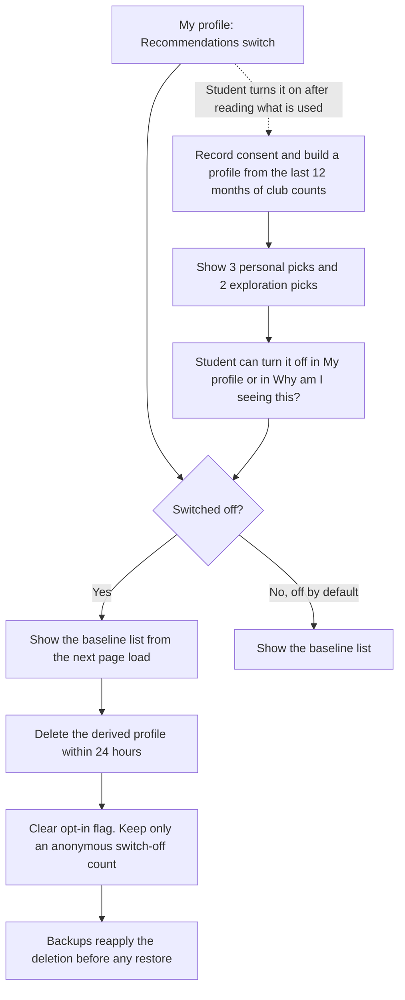

# AI feature proposal: "Recommended for you"
Version 0.1 · 2026-11-11 · Authors: <Oeung Keangheang>

Request from the clubs office: a list of five upcoming events chosen for each student from their attendance history. This proposal lets the client accept or reject the feature before any code is written. It builds on `data-inventory.md` (Task 1).

## 1 Problem and non-personalised baseline

**User problem.** Students find out about events late or never. The event list is long, sorted by date, and a student who has only been to one club's events rarely sees what other clubs offer. Small clubs say they struggle to be noticed.

**Baseline without personal data.** Ship these first. They use only event and club data, never student data.

| Baseline | What the student sees | Data used |
|----------|-----------------------|-----------|
| Popular this week | The five upcoming events with the most registrations in the last 7 days | Event registration counts (aggregate) |
| Events of my clubs | Upcoming events of clubs the student has joined | clubMemberships, which the student already sees in *My clubs* |
| Starting soon | The next five events in the next 7 days that still have free seats | Event data only |

The baseline solves most of the discovery problem. It fails in one way: it cannot show a student a club they have never heard of. That gap is the only thing the personalised feature adds, so the feature must be judged against the baseline, not against nothing.

## 2 Data needed

| Field | Source | In inventory? | New purpose / consent? | Minimisation |
|-------|--------|---------------|------------------------|--------------|
| studentId | data/students.csv | Yes (Mask) | No new purpose. Used only as an internal key. | Never shown in the list or the explanation. |
| clubMemberships | data/memberships.csv | Yes (Keep) | **Yes.** Currently used only for access checks and *My clubs*. Needs opt-in consent for recommendations. | Current memberships only, no history. |
| attendance | data/registrations.csv, then data/attendance-totals.csv | Yes (Aggregate) | **Yes.** The inventory keeps individual check-ins for one month. A 12-month signal needs a new purpose and consent. | Store only a count of check-ins per club per month, for the last 12 months. No event titles, no times. |
| recommendationsOptIn | data/students.csv | **No, new row** | Consent, withdrawable at any time | One boolean. Off by default. |
| derivedProfile (club counts) | data/recommendation-profiles.csv | **No, new row** | Consent, same as above | Only for opted-in students. Rebuilt each month. Deleted on opt-out. |
| Event fields (club, date, category, fee, location, accessibility notes) | data/events.csv | Not personal data | No | Used as given. |

**Not used:** name, email, phone, dateOfBirth, profilePhoto, telegramHandle and any free-text field. Sponsor information is never an input.

**Task 1 decisions that would change**
1. **attendance** (Aggregate): purpose, legal basis and retention change for opted-in students. The legal basis moves from legitimate interest to consent for this use. Retention is 12 months of club counts instead of one month of check-ins. The monthly club totals for the administrator stay as they are.
2. **clubMemberships** (Keep): a new reader is added, the recommender, and only for opted-in students.
3. **Two new rows:** recommendationsOptIn and derivedProfile.
4. **Copies of personal data:** backups must reapply opt-outs before a restore. Test fixtures use fictional students only. A screenshot of a recommendation list uses the demo data.
5. **Dropped fields stay dropped.** Better recommendations are not a purpose for collecting a birth date, a photo or a Telegram handle.

## 3 Bias risks

"Fair share" means a club's share of all upcoming events in the month.

| Risk | Who is harmed | Mitigation | Fairness check (metric, threshold) |
|------|---------------|------------|------------------------------------|
| **Cold start**: new students have no history | First-year and new members, who get weak or empty lists | Fall back to the baseline until the student has at least 3 check-ins. The list always has five items. | Share of new students with a full five-item list is 100 %. Their registration rate from the list is at least 80 % of the rate of established students. |
| **Popularity feedback loop**: popular events get shown, so they get more registrations, so they get shown again | Small and new clubs | At least 2 of the 5 slots show events from clubs the student has never attended. Registration counts are capped when used as a signal. | The top 3 clubs receive no more than 2 times their fair share of recommendations. |
| **Attendance as a proxy for money, distance or disability**: students who live far away, work in the evening, cannot pay a fee or find a venue hard to reach attend less, and the model learns to show them less | Students with low income, long commutes or disabilities | Never use time of day, location or fee as a learned signal. Free and on-campus events are always eligible. No attempt to guess why a student attends little. | The share of recommended events that are free is at least the free share of all upcoming events, minus 5 percentage points. The same check for events that are accessible. |
| **Large clubs crowd out small clubs** | Clubs with fewer than 20 members | Cap any one club at 2 of the 5 slots. Reserve one slot for a small club. | Clubs with fewer than 20 members receive at least 80 % of their fair share of recommendations. |
| **Sponsor influence**: sponsored clubs (phone shops, banks, cafés) gain visibility | Unsponsored clubs and students, who are shown ads as advice | Sponsorship is never an input. No paid placement. | The share of recommendations going to sponsored clubs is at most 1.1 times their fair share. |

Each check is run on the monthly report. A failed check triggers the review described in section 6.

## 4 Transparency

**"Why am I seeing this?" for one example event**

> **Intro to Arduino · Robotics Club · 2026-11-20 17:30**
> Recommended because you attended 3 Robotics Club events in the last 12 months.
> This is one of 3 picks based on your history. The other 2 picks are from clubs you have not tried yet, to help you discover new ones.
> We use only your club memberships and check-in counts per club. We do not use your name, contact details or the fees and locations of events you attended.
> **[Not interested]** **[Turn off recommendations]** **[How this works]**

An exploration pick reads: "Shown because it is happening soon and has free seats. Not based on your history."

**Ranking inputs the clubs office could publish**

1. Your check-in counts per club in the last 12 months (only if you turned recommendations on).
2. Your current club memberships.
3. Event start date: events in the next 14 days rank higher.
4. Free seats: full events are not shown.
5. Event popularity, capped so it cannot dominate.

**Not used:** name, email, phone, age, photo, Telegram, time of day or location of past attendance, event fee, sponsorship and any text you wrote.

The office also publishes the monthly fairness results from section 3.

## 5 Opt-out design

**Decision: opt-in, off by default.**
- The feature reuses attendance for a purpose students did not give it for. Under purpose limitation, that needs fresh, explicit consent.
- The baseline already serves everyone, so an opted-out student loses very little. Consent is therefore genuinely free: nothing is withheld as a penalty.
- The inventory treats the original attendance purpose as legitimate interest, which does not stretch to profiling.

**Where the switch lives.** *My profile*, section "Recommendations", with one sentence about what is used and a link to "How this works". The "Turn off" action is also in the "Why am I seeing this?" box on every recommendation.

**When a student switches it off**
1. Personalisation stops immediately. The list shows the baseline from the next page load.
2. The derived profile is deleted within 24 hours. Per-club counts built for recommendations are deleted with it.
3. The opt-in flag is cleared. The system records only an anonymous count of switch-offs for the fairness report.
4. Backups reapply the deletion before any restore is made available, as in the inventory.
5. Monthly club totals for the administrator remain. They contain no individual rows.

## 6 Recommendation

**Decision: GO WITH CONDITIONS**, not before Sprint 2, and only after the baseline has been live for one month.

**Conditions**
1. Opt-in, off by default. Switching off deletes the student's derived profile within 24 hours.
2. The feature uses only attendance of the last 12 months, stored as club counts, and club memberships. No phone, no email, no free text.
3. At least 2 of the 5 slots show events from clubs the student has never attended.
4. Monthly fairness checks from section 3 pass. A check that fails twice in a row switches personalisation off until it is fixed.
5. The inventory, privacy notice and consent step are updated before release, and students are told what changed.
6. A comparison with the baseline after two months. If personalisation does not clearly beat the baseline, remove it.

**Owner of the fairness check:** the clubs office (the data controller), through a named staff member. The Product Owner prepares the monthly report until the clubs office takes it over.

**Why not an unconditional GO.** The baseline fixes most of the stated problem without personal data. The personalised part needs consent, extra retention and ongoing monitoring, and each of those is a cost the baseline does not carry.