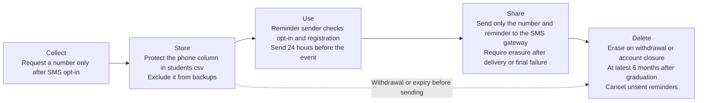

# Data inventory · ITC Club Hub
Version 0.2 · 2026-11-11 · Authors: Sok Chungseang

| Field | Subject | Purpose | Legal basis / consent | Retention | Who can see it | Stored in | Decision |
|-------|---------|---------|-----------------------|-----------|----------------|-----------|----------|
| **studentId** | Student | Identify the student account and prevent duplicate registrations for the same event. | Necessary because registration needs a stable identifier to enforce the one-registration rule. | Delete on account closure. Delete registration links on cancellation, account closure or 30 days after the event month ends, whichever comes first. | Student sees their own full ID. Administrator sees the full ID for account support. Assigned organiser sees only **maskId()** output. | **data/students.csv** and **data/registrations.csv** | **Mask**. The registration rule needs the full ID internally while the organiser can confirm a match using the masked ID. |
| **name** | Student | Display the student's name in "*My profile*" and on the assigned organiser's check-in roster. | Necessary because organisers need a recognisable name to confirm the correct registration at the door. | Delete on account closure. Remove the name from the event roster when the registration link is deleted. | Student, assigned organiser during check-in, and administrator for account support. | **data/students.csv** | **Keep**. A name lets the organiser confirm the student without displaying the full ID. |
| **email** | Student | Verify the account, send registration confirmations and send event reminders if the student enables email reminders. | Necessary because account verification and registration confirmations need a verified address. Email reminders require a separate opt-in. | Replace the old address when the new address is verified and delete the current address on account closure. Stop optional reminders immediately when disabled. | Student and administrator for account support. The mail sender reads it to deliver the allowed messages. | **data/students.csv** | **Keep**. A single verified address covers account verification and registration confirmations. |
| **phone** | Student | Send an SMS reminder 24 hours before an event if the student is registered and has enabled SMS reminders in *My profile*. Also enable us to contact them if anything were to happen. | Consent because SMS is optional and the student can withdraw at any time in *My profile*. | Erase immediately on withdrawal or account closure, or six months after graduation if earlier. | Student enters the number and sees only SMS status after saving. | **data/students.csv** | **Keep optional**. SMS can reach students who lack mobile data. |
| **clubMemberships** | Student | Show active memberships in *My clubs* and verify access to member-only events. | Necessary because Club Hub must know which students qualify for member-only events. | Delete a membership when the student leaves the club, the club closes or the account closes, whichever comes first. | Student, club leader for their own club and administrator for membership support. Organisers get only the event eligibility result. | **data/memberships.csv** | **Keep**. Current memberships support access checks without requiring a history of former memberships. |
| **attendance** | Student | Confirm individual check-ins and produce the administrator's monthly club attendance report. | Legitimate interest because short-lived check-in records support corrections and reconciled counts for event planning. | Delete after a month.| Student sees own status. Assigned organiser sees individual check-ins while the event is open. Administrator sees counts in the monthly report. | **data/registrations.csv** for temporary check-ins and **data/attendance-totals.csv** for monthly club totals. | **Aggregate**. Monthly club totals support planning after the identifiable check-in rows are deleted. |
| **remindersByEmail** | Student | Store the email-reminder switch in *My profile* and check it before sending optional reminders. | Consent because the student separately opts in to email reminders and can turn them off. | Off by default. Clear the stored opt-in immediately when the student turns it off or closes the account. | Student see the sent email and the reminder sender see the email being sent. | **data/students.csv** | **Keep optional**. The sender needs one setting to respect the student's reminder choice. |
| **dateOfBirth** | Student | Not really a purpose. | None because there is no feature that needs a birth date. | Never collected. | If summited administrator and student. | No file. | **Drop**. An exact birth date adds identifying information without serving an event rule. |
| **profilePhoto** | Student | Vidual Identification | None because the existing roster and masked ID meet the check-in need. | Never collected. | If summited administrator and student. | No file. | **Drop**. A photo adds identifying information when the name and masked ID already support check-in. |
| **telegramHandle** | Student | Telegram channels and further info on the event. | Consent though adviced to join the telegram groupchat. | Never collected. | If summited administrator and student. | No file. | **Drop**. Collecting a social account identifier would duplicate the existing reminder channels. |

## Copies of personal data
| Copy | Rule |
|------|------|
| log files | only `redacted()` output, never name, email or phone |
| CSV exports | Allow administrators to export only the approved monthly club totals, including the suppression rule. Exclude student rows and delete saved exports within 30 days of download or at the report's expiry. |
| test fixtures | Generate fictional records and use test-only contact addresses and numbers with outbound delivery disabled. Exclude live data and scrubbed copies of live rows. |
| backups | Encrypt backups, restrict restores to authorised administrators and expire copies 30 days after creation. Exclude phone numbers, and reapply recorded deletions and withdrawals before a restore is made available. |
| screenshots in docs | Use a demo populated with fictional records and review the entire image for real personal data before committing or sharing it. |

## Lifecycle of the phone field

## Client feedback
| Dropped field | Client objection | Outcome |
|---|---|---|
| profilePhoto | Organisers at a busy door may want a photo to spot fake registrations. | Dropped stays. Name plus masked ID is enough, and the student can show their student card if there is a dispute. |
| telegramHandle | Club leaders already run Telegram groups and want to reach members. | Dropped stays. The event page can show the group's join link, so there is no per-student handle to store. |
| attendance (Aggregate) | The clubs office wants to see who attended, not only monthly totals, to spot very active members. | Aggregate stays. The monthly report only needs club totals. Individual history is not an approved purpose, and it would need a new inventory row and a consent basis first. |
