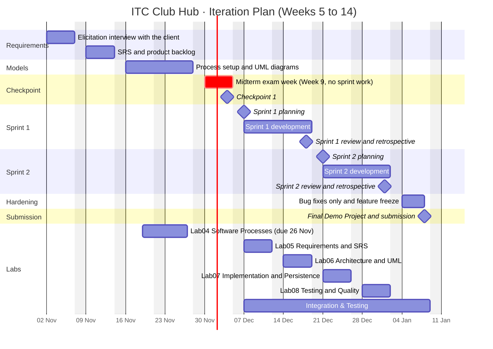

# Iteration Plan (Weeks 5 to 14) · Team CertifiedVibeCoder
Version 1.0 · 2026-11-26 · Lead: Scrum Master (Sprint 1: Sok Chungseang)
---
## 1. Semester Gantt Chart (Mermaid)

---
## 2. Iteration Goals and Capacity Table
### Capacity Formula:
$$\text{Capacity} = \text{Members (5)} \times \text{Hours/Week (6)} \times \text{Duration (2 weeks)} \times 0.8\text{ (Focus Factor)} = \mathbf{48\text{ h}}$$
| Iteration | Weeks | Calendar Dates | Parallel Lab / Event | Goal | Candidate Features | Capacity | Exit Criterion |
| :--- | :---: | :---: | :---: | :--- | :--- | :---: | :--- |
| **Requirements** | 5–6 | Nov 02 – Nov 13 | Earlier labs (Lab02/Lab03) | Interview the client to clarify Club Hub rules and draft the initial SRS and backlog. | Student & club-lead user stories, domain rules. | 5 × 6 × 2 × 0.8 = 48 h | Initial SRS and prioritized product backlog reviewed by the team. |
| **Models & Process** | 7–8 | Nov 16 – Nov 27 | **Lab04 (due Nov 26)** | Finalize process decisions (PDR-001) and design Club Hub's domain and interaction UML models. | PDR-001, rapidcsv/GoogleTest smoke setup, use-case & domain class diagrams. | 5 × 6 × 2 × 0.8 = 48 h | Lab04 submitted by Nov 26 and UML models aligned with Must-have requirements. |
| **Checkpoint 1** | 9 | Nov 30 – Dec 04 | **Midterm Exam** | Pause sprint development for Week 9 midterm exams and pass the Checkpoint 1 review. | Checkpoint readiness check and specification/model audit (no sprint coding). | 0 h sprint (~8 h prep) | Checkpoint 1 deliverables accepted by the TA/instructor on Dec 04. |
| **Sprint 1** | 10–11 | Dec 07 – Dec 18 | Lab05 (Wk 10), Lab06 (Wk 11), Integration & Testing | Deliver a working CLI slice where students load CSV events, browse upcoming sessions, and register. | rapidcsv event loader, browse/list CLI view, registration with capacity & duplicate checks. | **48 h** (5 × 6 × 2 × 0.8) | Sprint 1 Must stories demoed to the TA on Dec 18 with all GoogleTest unit tests green in CI. |
| **Sprint 2** | 12–13 | Dec 21 – Jan 01 | Lab07 (Wk 12), Lab08 (Wk 13), Integration & Testing | Add 24-hour cancellation enforcement, club event creation, CSV save-back, and monthly summaries. | Cancel booking (>= 24 h cutoff), club event creation, CSV write-back, monthly club report. | **48 h** (5 × 6 × 2 × 0.8) | Changes persist across CLI runs, full CTest suite passes, and Sprint 2 demo is accepted on Jan 01. |
| **Hardening & Submission** | 14 | Jan 04 – Jan 08 | Final Demo Project, Integration & Testing | Freeze features to fix final defects, polish documentation, and deliver the Final Demo Project. | Malformed CLI/CSV input guards, regression check, CHANGELOG.md, v1.0.0 release tag & live demo. | 5 × 6 × 1 × 0.8 = 24 h | Zero open critical/major bugs, v1.0.0 merged & tagged on main, and Final Demo completed on Jan 08. |
