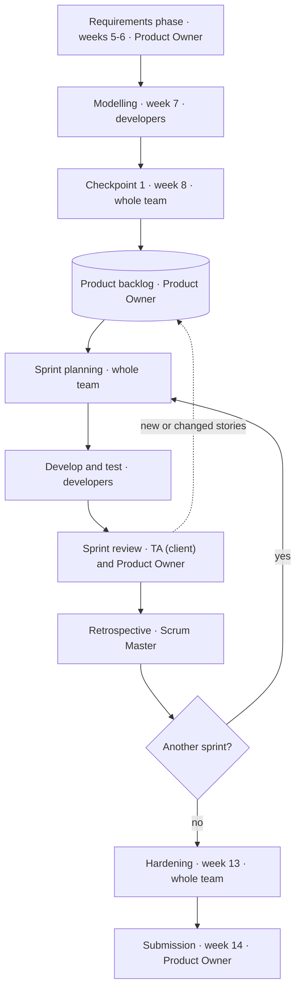

# PDR-001 - Development process for ITC Club Hub
Status: Proposed
Date: 2026-11-26        Deciders: Oeung Keangheang, Sok ChungSeang, Seng Sarak, Song PanhaSeth, Pheng Sopheak

## Context
1. Team size is 5 members, all reachable on Telegram between 10:00 AM and 3:00 PM Monday to Friday, with limited weekly hours for the project alongside other courses (source: lab-01/team-charter.md)
2. The client (TA) is available for about 30 minutes every Friday, enough for a bi-weekly sprint review but not for daily questions (source: case-study brief)
3. Fixed milestones: Checkpoint 1 in week 8 (blocked by midterms) and a hard submission and demo in week 14 (source: case-study brief)
4. Requirements are only partly clear today: the core registration and 24-hour cancellation rules are in the brief, but the CLI details and edge cases will evolve after week-5 elicitation (source: problem statement)
5. The team is still learning C++20, CMake (FetchContent), GoogleTest and Scrum ceremonies at the same time (source: lab-01/team-charter.md)

## Options considered
| Option                       | Weighted score (Task 2) | Pro | Con |
|------------------------------|------------------------:|-----|-----|
| A. Waterfall                 | 1.80                    | Clear plan and documents from the start | Late feedback, and our CLI requirements will change after week 5 |
| B. Incremental delivery      | 3.80                    | Working parts appear early and fit the deadline well | Fewer planned review points with the TA |
| C. Scrum-style iterative     | 4.60                    | Sprint demos with the TA and early CI show misunderstandings before week 13 | Ceremonies take time while we are still learning C++20, CMake and Scrum |
| D. No defined process        | n/a                     | No overhead | No shared way of working, so milestones and tasks get missed |

## Decision
We will use a hybrid: a short up-front phase (requirements in weeks 5-6 and modelling in week 7), then Scrum-style sprints in weeks 9-12, then hardening in week 13 and submission in week 14, because it keeps Scrum's feedback and early working code but also gives us a plan and a model for the week 8 checkpoint and protects the hard week 14 deadline.
This is not exactly the Task 2 winner (C, Scrum-style, 4.60). It is Scrum with extra up-front work and a hardening phase, because our Task 2 conclusion showed that a hybrid offsets our lower experience while keeping Scrum's adaptability and deadline safety.

| Element | Reference practice | Our tailoring | Reason |
|---------|--------------------|---------------|--------|
| Up-front work | Scrum: almost none; Waterfall: full design | Requirements (SRS) in weeks 5-6 and UML modelling in week 7, then Checkpoint 1 in week 8 | The week 8 checkpoint needs a plan and a model, and week 8 is blocked by midterms |
| Iteration length | Scrum: 2-4 week sprints | Two 2-week sprints in weeks 9-12 | Matches the bi-weekly TA review and our limited weekly hours |
| Meetings | Scrum: planning, daily stand-up, review, retrospective | Planning, review and retrospective once per sprint, all timeboxed; no daily stand-up (quick updates on Telegram instead); sprint review uses the TA's Friday 30-minute slot | Keeps ceremony overhead low while we learn the tools |
| Roles | Scrum: Product Owner, Scrum Master, developers | Product Owner: Oeung Keangheang (all semester). Scrum Master rotates: Sok ChungSeang in sprint 1, Seng Sarak in sprint 2. Developers: everyone else (Song PanhaSeth, Pheng Sopheak, and the Scrum Master outside their role duties) | Matches the team charter; every member has one clear responsibility |
| Documents | Scrum: light; Waterfall: heavy | Only SRS, UML model, product backlog, this PDR and test notes | Enough to follow and mark, nothing extra |
| Definition of Done | Scrum: agreed by the team | Code builds with CMake, has GoogleTest tests that pass in CI, is reviewed by one other member within 24 hours (charter rule) and merged | Early tests and CI expose misunderstood business rules |
| Hardening | Waterfall: test phase at the end | Week 13 only for bug fixing, testing and final checks | Safe buffer before the hard week 14 submission |

## Consequences
Positive:
- Working code is ready early, so we avoid risky late integration before week 14.
- Early GoogleTest CI and sprint demos expose misunderstood business rules (such as the 24-hour cancellation cutoff) well before week 13.
- The TA sees progress every two weeks and can change the stories.

Negative / risks (with mitigation):
- Sprint ceremonies can eat into our limited weekly hours -> keep every ceremony strictly timeboxed.
- The TA is only available for 30 minutes on Fridays -> prepare a concrete demo agenda for each review and collect questions in writing between reviews.
- Learning C++20, CMake and GoogleTest at the same time can slow the sprints -> plan small slices and use the weekly labs for tooling help.

## Process diagram (source: lab04/process.mmd)

## Approvals
- Pheng Sopheak, 26-11-2026 : approved
- Sok Chungseang, 26-11-2026 : approved
- Song Panhaseth, 26-11-2026 : approved
- Seng Sarak, 26-11-2026 : approved

